<div align="center">

# SplitPay

### Split the bill. Settle in seconds.

A payments app for Android that signs you in with your real PayPal account, pays friends by email or QR, and turns a photo of a restaurant bill into a payment link for every person at the table.


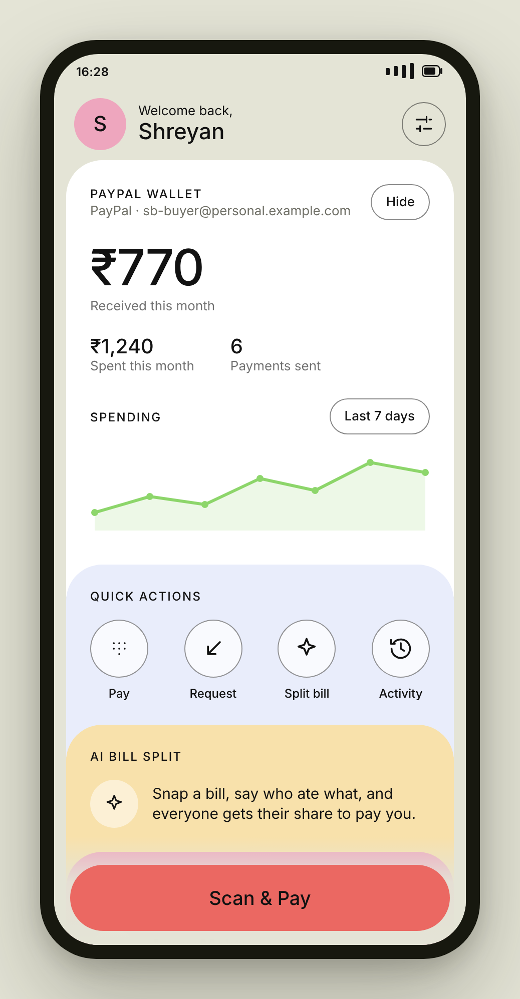 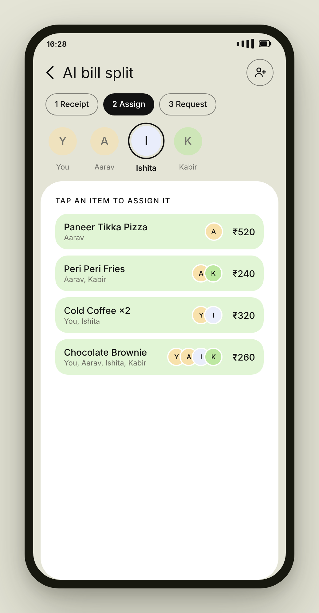 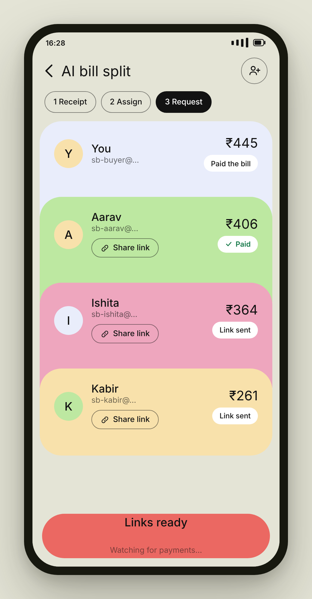

</div>

---

## The problem

Four people eat together. One person pays. Then comes the part nobody enjoys: working out who owes what, typing it into a group chat, and chasing everyone for a week.

SplitPay removes every step of that. Photograph the bill, tap who ate what, and each person gets their own payment link. Money lands in the payer's PayPal account, and the app watches the payments come in by itself.

---

## What it does

| | |
|---|---|
| **Log in with PayPal** | Real OAuth (OpenID Connect). No invented accounts, no password to remember. Your name and PayPal email come straight from PayPal. |
| **Pay anyone by email** | Enter an amount, confirm with your PIN, approve in PayPal. The money moves on PayPal's rails, not a simulation. |
| **Scan & Pay** | Every account gets a real QR code. Scan a friend's, and the amount screen opens with them already filled in. |
| **AI bill split** | A vision model reads the receipt into line items. Tap who ate what, and every share is calculated, tax included. |
| **One link per friend** | Each person gets their own PayPal checkout link. Rows flip to **Paid** on their own as money arrives. |
| **Request money** | Make a link for any amount and send it anywhere. The other person needs no app and no account in SplitPay. |
| **Real history** | Only payments that actually went through PayPal appear. Nothing on the screen is placeholder data. |
| **Your own PIN** | A 4-digit PIN opens the app and confirms every payment. Stored as a salted SHA-256 hash; five wrong tries lock entry for 30 seconds. |

---

## Screens

<div align="center">

### Getting in

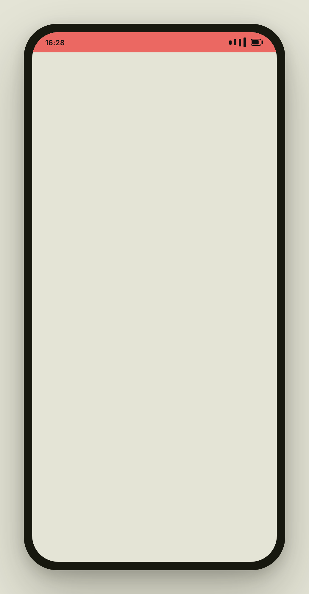 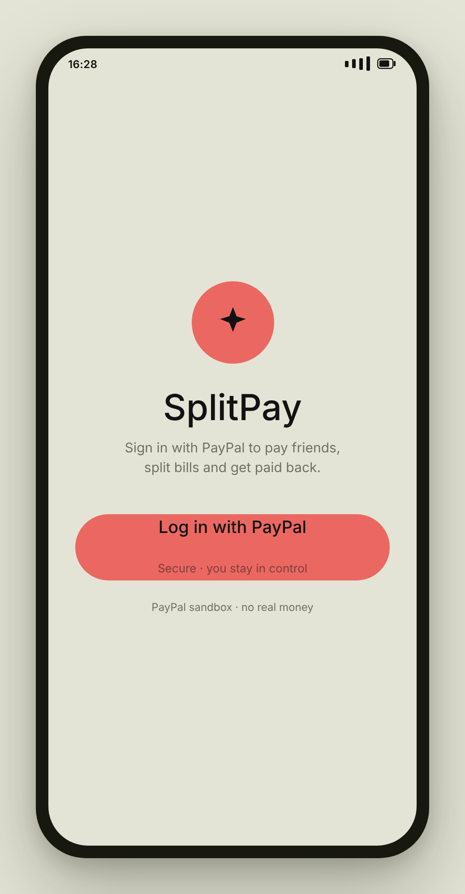  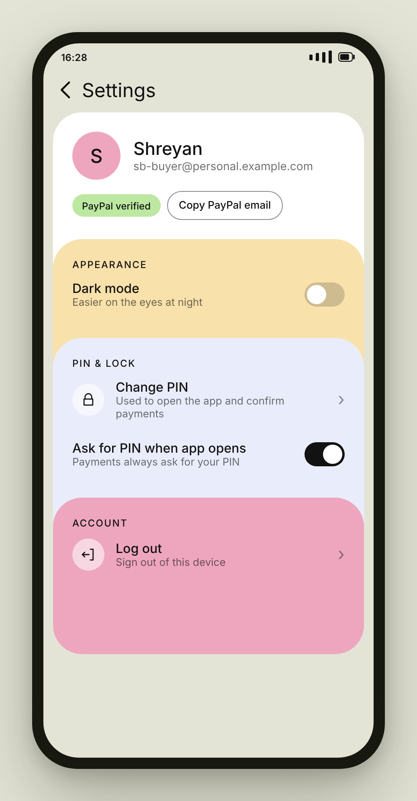

Splash & PIN · Log in with PayPal · Home · Settings

### Paying someone

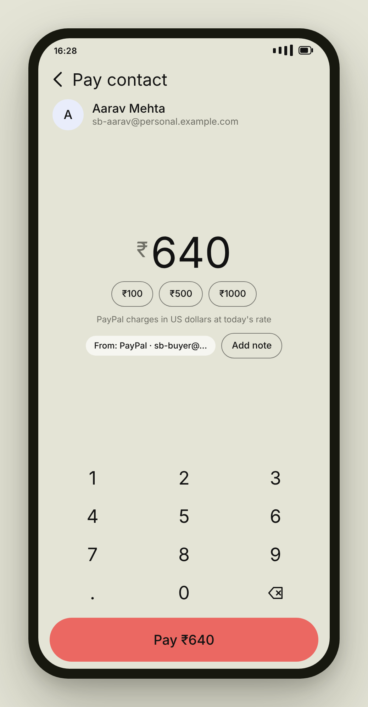 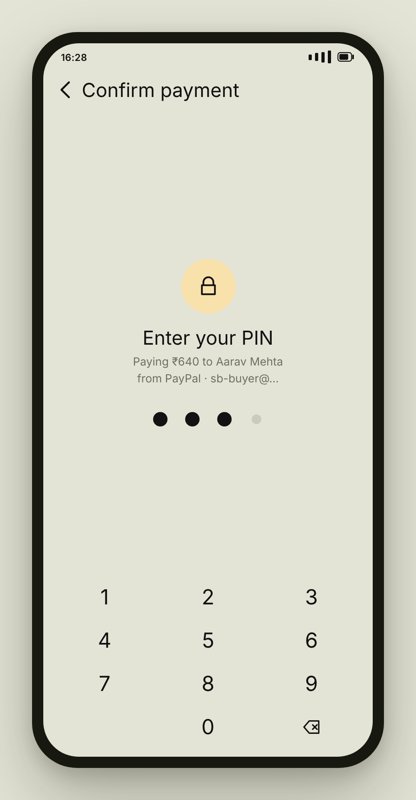 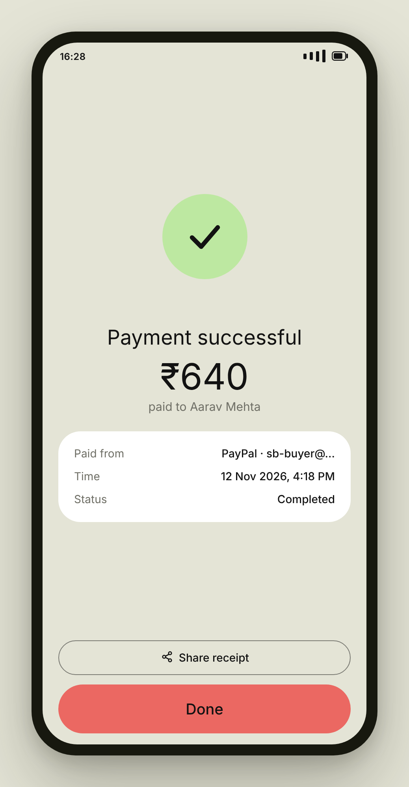 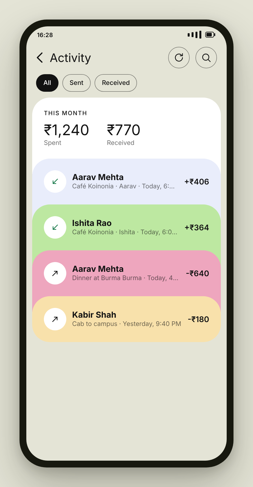

Amount · Confirm with PIN · Done · Activity

### Face to face

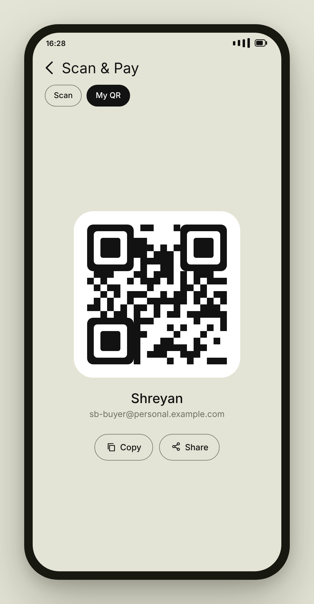 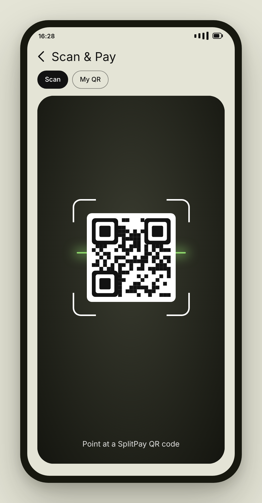 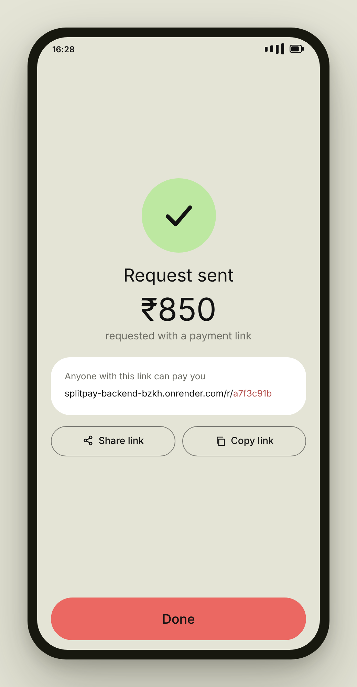

My QR code · Scanner · Request-money link

### AI bill split

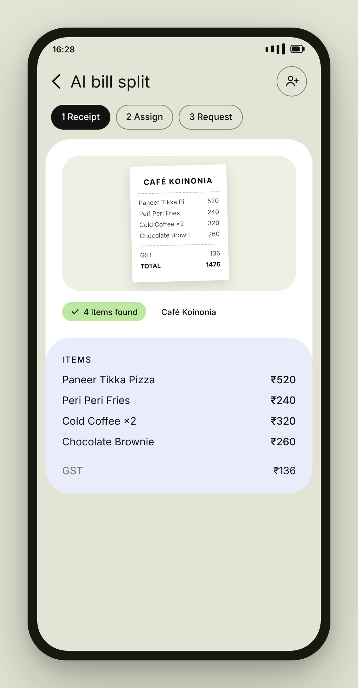  

Receipt read into items · Assign who ate what · A link each, paid to you

</div>

---

## How it works

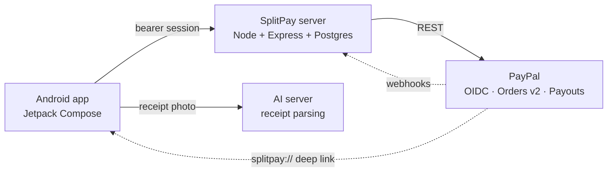

The app holds no PayPal secrets. It calls its own server, and only the server talks to PayPal with the client secret. PayPal returns the user to the app through a `splitpay://` deep link.

### What happens when you pay

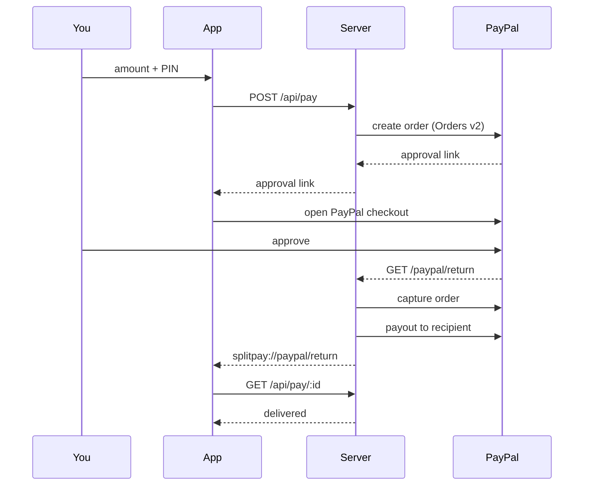

Amounts are held as integer minor units (paise) and converted to USD at `INR_PER_USD` before they reach PayPal, so rounding never loses a rupee. Capture and payout are both idempotent: reloading the return page cannot charge anyone twice.

---

## Built with

| Layer | What's in it |
|---|---|
| **App** | Kotlin · Jetpack Compose · Material 3 · StateFlow · OkHttp · ML Kit barcode scanning · ZXing (QR generation) · kotlinx.serialization |
| **Server** | Node 18 · Express 4 · PostgreSQL (`pg`) · zero-dependency crypto sessions |
| **PayPal** | Log in with PayPal (OpenID Connect) · Orders v2 · Payouts · webhook signature verification |
| **AI** | Vision model reads the receipt into structured line items |
| **Hosting** | Render (free web service + free Postgres) |

The UI is hand-built: a custom palette, stacked pastel cards, a jelly "Scan & Pay" button, spring animations and haptics throughout. No UI kit.

---

## Running it yourself

### 1. PayPal

1. At [developer.paypal.com](https://developer.paypal.com), create a **Sandbox** REST app and copy the **Client ID** and **Secret**.
2. In that app, tick **Log in with PayPal**, request **full name** and **email address**, and set the Return URL to `https://<your-server>/auth/callback`.
3. Under **Testing tools → Sandbox accounts**, create two **Personal** accounts and set a password on each. These are the people who will pay each other.

### 2. Server

```bash
npm install
cp .env.example .env     # fill in the values below
npm start
```

| Variable | What it is |
|---|---|
| `PAYPAL_ENV` | `sandbox` or `live` |
| `PAYPAL_CLIENT_ID` | from your PayPal app |
| `PAYPAL_CLIENT_SECRET` | from your PayPal app |
| `DATABASE_URL` | Postgres URL; without it the server falls back to a local JSON file |
| `INR_PER_USD` | conversion rate, default `84` |
| `PUBLIC_URL` | the server's own HTTPS address; filled in automatically on Render |
| `PAYPAL_WEBHOOK_ID` | optional, needed only for payout webhooks |

To deploy on Render: **New → Web Service**, build `npm install`, start `npm start`, add a free Postgres instance, and paste the variables above. Open `/health` and expect `{"ok":true}`.

### 3. App

1. Open the project in Android Studio.
2. In `AppConfig.kt`, set `SERVER_URL` to your server's address, with no trailing slash.
3. **Sync Now**, then run on a device with Android 8.0 or newer.

---

## API

All `/api/*` routes need `Authorization: Bearer <token>`, which the app receives from the login deep link.

| Method | Route | Purpose |
|---|---|---|
| `GET` | `/health` | liveness |
| `GET` | `/auth/login` | redirect into Log in with PayPal |
| `GET` | `/auth/callback` | exchange the code, create a session, return to the app |
| `GET` | `/api/me` | who is logged in |
| `POST` | `/api/logout` | end the session |
| `POST` | `/api/pay` | start a payment → `{ paymentId, approveUrl }` |
| `GET` | `/api/pay/:id` | payment status |
| `POST` | `/api/request` | make a request-money link → `{ payUrl }` |
| `GET` | `/r/:id` | open a request link and send the payer to PayPal |
| `POST` | `/api/split` | one payment link per friend → `{ splitId, members[] }` |
| `GET` | `/api/split/:id` | who has paid, and how much is collected |
| `GET` | `/api/history` | payments you sent or received |
| `GET` | `/paypal/return` · `/paypal/cancel` | PayPal sends the browser back here |
| `POST` | `/webhooks/paypal` | signature-verified payout receipts |

---

## Security notes

- The PayPal client secret lives only on the server. The app never sees it.
- Sessions are random 32-byte tokens; only their SHA-256 hash is stored.
- The PIN never leaves the phone and is stored as a salted SHA-256 hash, never in plain text.
- Card numbers are never collected or stored anywhere. PayPal handles every card.
- Webhooks are verified against PayPal's signature API before anything is acted on.

---

## Honest limitations

This is a hackathon build. Where it falls short, it says so:

- **Sandbox only.** Live PayPal needs business verification, and Log in with PayPal needs PayPal's review before it can go live.
- **Payouts are not available to Indian accounts.** PayPal refuses the final transfer, so in sandbox the payment is captured into the platform account and marked complete. In a live deployment from a supported country, the payout step runs as written.
- **PayPal gives apps no access to a personal balance or transaction history.** Home shows money that moved through SplitPay, not your whole PayPal account.
- **The free Render instance sleeps** after 15 idle minutes, so the first request can take up to a minute. The app pings `/health` on launch to wake it early.

---

## What's next

- Route splits through a single checkout instead of one link per person
- Push notifications when a friend pays
- Recurring splits for rent and subscriptions
- Live mode once PayPal review is complete

---

<div align="center">

Built for the PayPal hackathon.

</div>
